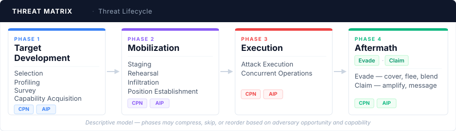
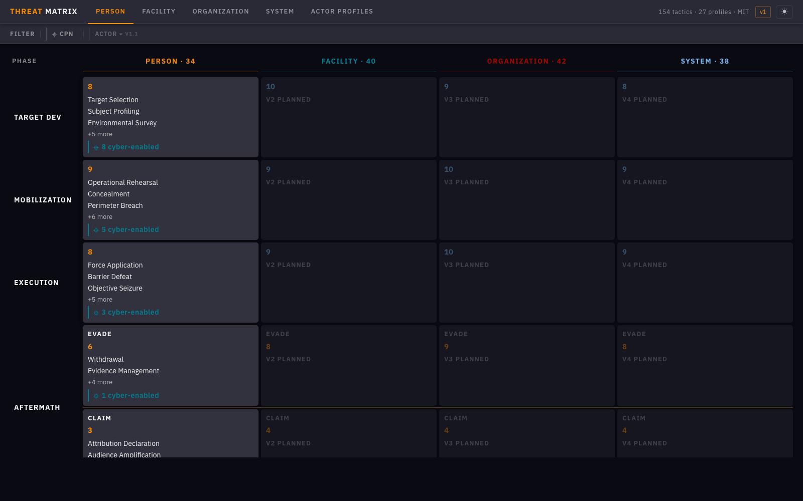
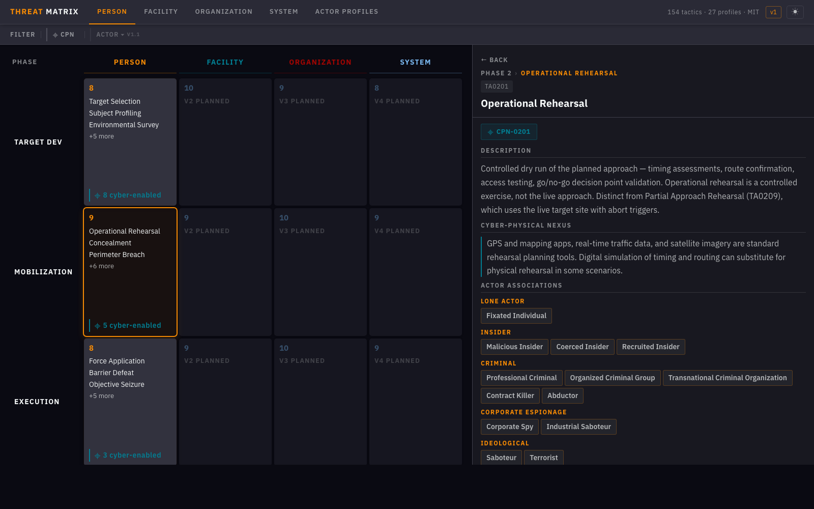

# THREAT Matrix

*Tactical Human Risk Enumeration and Adversary Taxonomy Matrix*

An open behavioral vocabulary and evidence index for threat assessment and protective work: named, identified descriptions of observable behavior, organized by target and phase, each tied to public sources.

> ## Limitations and intended use
>
> **What this is.** A shared set of terms for behavior that threat assessment and protective teams observe, with the public sources each term draws on. Entries are authored descriptions of classes of behavior. They are not findings about any person or case.
>
> **Intended uses.** A shared vocabulary across teams. A training and case-discussion reference. A tagging and interchange layer between tools. A structure for documenting what was observed and where the information came from.
>
> **What this is not.**
> - Not a risk assessment instrument.
> - Not predictive. Nothing here estimates whether a person will act.
> - Not validated against outcomes.
> - Not a score of any person.
> - Not grounds, by itself, for adverse action against anyone.
> - Not a substitute for individualized assessment by qualified professionals.
> - Not legal advice.
>
> **Sources.** Every entry cites public sources. Source support varies in strength. 425 of the 828 indicators cite a single source, 8 of the 120 bibliography entries have neither a URL nor a DOI, and a citation shows where a behavior is discussed, not that the source confirms every detail of the entry.
>
> **Scoring.** The vocabulary carries no scores. A separate file holds an experimental scoring overlay. It is non-normative, unvalidated, opt-in, and outside the vocabulary contract. See [Experimental scoring overlay](#experimental-scoring-overlay) at the end of this page.
>
> **Maturity.** The People and Facilities matrices are the core. The Organizations and Infrastructure matrices are drafts. Some Organizations entries describe conduct that can be lawful, protected activity, such as protest, boycott, litigation, regulatory complaint, shareholder action, and public criticism. Such an entry must never be treated as an indicator of threat without independent evidence of unlawful or violent intent.
>
> **Bias and privacy.** A behavior label attached to a person can follow that person. Apply the same threshold to everyone, do not treat a protected characteristic, a belief, a diagnosis, or protected activity as an indicator, record sources, and collect and keep only what your law and policy allow. In a case record about a person who has not been assessed as posing a threat, the vocabulary's label "threat actor" is rendered "person of concern".
>
> **Reliability.** No reliability study has been run. A study of whether independent practitioners agree on which indicators are present in written case narratives is planned; its protocol is a draft. See [docs/study/README.md](docs/study/README.md).
>
> The full statement is in [docs/METHODOLOGY.md](docs/METHODOLOGY.md#limitations-and-intended-use).

**[Open the viewer](https://jgulyash.github.io/THREAT-Matrix/)** · [Vocabulary file](docs/data/framework.json) · [Schema](docs/data/framework.schema.json) · [Methodology](docs/METHODOLOGY.md) · MIT License

---

## What is in the repository

| Part | Where | What it is |
|---|---|---|
| Vocabulary | [`docs/data/framework.json`](docs/data/framework.json) | Tactics, indicators, countermeasures, response protocols, actor profiles, and the bibliography. No scores. |
| Schemas | [`docs/data/framework.schema.json`](docs/data/framework.schema.json), [`case-record.schema.json`](docs/data/case-record.schema.json), [`coverage.schema.json`](docs/data/coverage.schema.json), [`id-manifest.schema.json`](docs/data/id-manifest.schema.json) | JSON Schema (draft 2020-12) for the vocabulary, the score-free case record, an organization's own coverage records, and the ID manifest. |
| ID manifest | [`docs/data/id-manifest.json`](docs/data/id-manifest.json), [`docs/data/baselines/`](docs/data/baselines/id-manifest-1.7.0.json) | Every identifier in the release, plus reserved and removed identifiers. On every push and pull request it is compared with the vocabulary, with a committed baseline of the identifiers in the published 1.7.0 release, and with the previous manifest. An identifier that was in 1.7.0, or in the previous commit, cannot be dropped or reused without the check failing. The check does not compare content, so it cannot see an identifier whose text was replaced. |
| Score-free case record | [`examples/case-record-template.json`](examples/case-record-template.json), [`examples/case-record-worksheet.md`](examples/case-record-worksheet.md), [`examples/worked-cases/`](examples/worked-cases/README.md) | A record format for documenting observations, sources, context, protective factors, reassessments in either direction, and a disposition. Five fictional worked cases. The record has no score, band, weight, or priority field. |
| Viewer | [jgulyash.github.io/THREAT-Matrix](https://jgulyash.github.io/THREAT-Matrix/), source in `src/` | A static browser for the vocabulary. Score-free by default. |
| Tooling | [`scripts/`](scripts/), [`examples/python_consumer.py`](examples/python_consumer.py) | The validator and its fixtures, reference checks, the ID manifest tool, a flat export, a migration tool, and a reference consumer. |
| Study protocol | [`docs/study/`](docs/study/README.md) | Draft protocol and empty scaffold for a planned reliability study. No data and no results. |
| Crosswalks | [`docs/crosswalks/`](docs/crosswalks/README.md) | Draft concept-level crosswalks: People tactics to published warning-behavior and pathway concepts, and Facilities tactics to PACT. Unreviewed. |
| Governance | [GOVERNANCE.md](GOVERNANCE.md), [MAINTAINERS.md](MAINTAINERS.md), [SECURITY.md](SECURITY.md), [CODE_OF_CONDUCT.md](CODE_OF_CONDUCT.md) | How the project is run today (one maintainer, all other seats vacant), private reporting, and conduct. |
| Experimental scoring overlay | [`docs/data/scoring-overlay.json`](docs/data/scoring-overlay.json), [`scoring-overlay.schema.json`](docs/data/scoring-overlay.schema.json), [`examples/experimental-scoring/`](examples/experimental-scoring/README.md) | Separate, opt-in, non-normative. Described only in the [last section](#experimental-scoring-overlay). |

Everything under `docs/` is published as a website by GitHub Pages, not only the viewer and the data. That includes material written for contributors rather than visitors, which is public on purpose: the writing rules ([docs/VOICE.md](docs/VOICE.md)), the validation run record ([docs/migration/3.0.0-validation-report.md](docs/migration/3.0.0-validation-report.md)), the pointer at [docs/methodology/README.md](docs/methodology/README.md), and the study's analysis scripts ([docs/study/analysis/](docs/study/analysis/)). Material that is not meant to be published is kept outside `docs/`, in `design/` and `drafts/`.

## The four matrices

Each tactic sits in exactly one matrix, set by what the threat actor's primary objective targets. Each matrix runs across four lifecycle phases: Target Development, Mobilization, Execution, and Aftermath. The phases describe common patterns, not a required sequence.



| Matrix | Maturity | Tactics | Indicators | Countermeasures | Response protocols |
|---|---|---:|---:|---:|---:|
| People | core | 34 | 191 | 137 | 69 |
| Facilities | core | 40 | 200 | 160 | 80 |
| Organizations | draft | 49 | 244 | 196 | 98 |
| Infrastructure | draft | 38 | 193 | 152 | 76 |
| **Total** | | **161** | **828** | **645** | **323** |

The vocabulary also holds 32 active actor profiles in seven categories (identifiers `AP001` to `AP034`; `AP022` and `AP027` are reserved and carry no content) and a bibliography of 120 public sources.

Maturity is recorded in the data as `matrices.<name>.maturity`. A draft matrix is published so it can be read and criticized. Its content is thinner, its sourcing is weaker, and it may change between versions. The Infrastructure matrix is derived almost entirely from published literature (37 of its 38 tactics are `literature_only`). The Organizations matrix needs the protected-activity caution in the box above.

What each object is:

- A **tactic** is a category of behavior, with notes, field notes, observed contexts, an `evidence_basis` value, and assessment guidance that includes false-positive context.
- An **indicator** is one observable behavior under a tactic, with its detection sources, a modality, a temporal signature, what observing it reveals (`informs_axes`), collection prompts (`conditioning_guidance`), and its sources.
- A **countermeasure** is a defensive measure under a tactic, with cost, complexity, time to implement, and limitations.
- A **response protocol** is a response sequence under a tactic, with stakeholders, an escalation trigger, and legal notes.
- An **actor profile** is a category of threat actor. Tactics refer to profiles by identifier.

Relations between objects (`correlates_with`, `mitigates`, `compensates_for`, `coordinates_with`) are described, with their current coverage and limits, in [docs/METHODOLOGY.md](docs/METHODOLOGY.md#3-relations-between-objects).

## How to use it

**Browse.** Open the [viewer](https://jgulyash.github.io/THREAT-Matrix/). It shows an overview of the four matrices, one matrix per tab, search, actor profiles, and the sources. Draft matrices are tagged. No score is shown unless you switch on the experimental overlay in the footer.





*These two screenshots are from the first (V1) viewer and are kept for orientation only. The counts, labels, and identifiers in them are historical. The current viewer differs.*

**Read the data.** The reference consumer loads the vocabulary, validates it against its schema, and prints a summary. It needs Python 3 and the `jsonschema` package, and reads local files only.

```
pip install jsonschema
python3 examples/python_consumer.py
python3 examples/python_consumer.py --phase 1
python3 examples/python_consumer.py --actor AP005
```

**Export flat files.** One JSON Lines file per object type plus a relationships file and an index with checksums. No scores are exported.

```
python3 scripts/export/flat.py --out out/flat
```

**Document a case.** Use the score-free case record: copy [`examples/case-record-template.json`](examples/case-record-template.json), read the [worksheet](examples/case-record-worksheet.md), and see the [worked cases](examples/worked-cases/README.md). Keep real records in your own case system. This repository holds no case data and accepts none.

**Check the data.** These are the project gates. Continuous integration runs every one of them on every push and pull request.

```
python3 scripts/lint/validate.py docs/data/framework.json
python3 scripts/lint/validate.py docs/data/framework.json --overlay docs/data/scoring-overlay.json
python3 scripts/lint/validate.py docs/data/framework.json --fixtures scripts/lint/fixtures
python3 scripts/lint/validate.py docs/data/framework.json --overlay docs/data/scoring-overlay.json --records examples/experimental-scoring/worked-cases
python3 scripts/lint/field-parity.py docs/data/framework.json
python3 scripts/lint/mesh-refs.py docs/data/framework.json
python3 scripts/lint/id-manifest.py --check docs/data/framework.json docs/data/id-manifest.json
python3 scripts/lint/consumer-smoke.py
```

What each gate does, and what no gate checks, is set out in [docs/METHODOLOGY.md](docs/METHODOLOGY.md#5-review-process-and-gates).

### Consumers

- **Viewer.** The static site above.
- **Reference Python consumer.** [`examples/python_consumer.py`](examples/python_consumer.py), with [`examples/README.md`](examples/README.md) as a starting guide.
- **Yours.** To list a consumer here, open a pull request that adds its name, language, link, a one-sentence description, and the vocabulary version it was tested against.

No outside consumer is known today.

## Sources and how to cite them

Every tactic, indicator, countermeasure, and response protocol carries a `source_refs` array of bibliography keys. Each key resolves to an entry under `bibliography` in [`docs/data/framework.json`](docs/data/framework.json) with a title, author, date, type, and a URL or DOI where one exists. All sources are public.

- To cite a source, cite the original work from its bibliography entry, not this project.
- To cite an entry of the vocabulary, give the identifier and the content version, for example "THREAT Matrix 2.0.0, IND-0101-01".
- No cited author, agency, or publisher has reviewed, approved, or endorsed this project or its use of their work. Publisher notices and third-party software notices are in [NOTICES.md](NOTICES.md).

## Versions

| Artifact | Version | Where it is recorded |
|---|---|---|
| Vocabulary content | 2.0.0 | `version` in `docs/data/framework.json` |
| Vocabulary schema | 3.0.0 | `schema_version` in `docs/data/framework.json` |
| Score-free case record | 1.0.0 | `record_version` in each record |
| Experimental scoring overlay | 0.1.0 | `overlay_version` in `docs/data/scoring-overlay.json` |

These are the versions on this branch. They are not yet released: the published release on `main` is content 1.7.0 with schema 2.1.0 until the 3.0.0 release is announced and tagged under [docs/VERSIONING.md](docs/VERSIONING.md). Anyone holding a copy of the published document should read the [migration guide](docs/migration/2.1-to-3.0.md).

## Documents

| Document | Covers |
|---|---|
| [docs/METHODOLOGY.md](docs/METHODOLOGY.md) | Limitations and intended use, how the vocabulary is written, relations, evidence basis, the review process and gates, the case record, reliability |
| [docs/VERSIONING.md](docs/VERSIONING.md) | What each version number means and the stability promise |
| [docs/IDENTIFIERS.md](docs/IDENTIFIERS.md) | Identifier formats, the no-reuse rule, the ID manifest |
| [docs/DEPRECATION.md](docs/DEPRECATION.md) | Lifecycle states and what consumers should do with each |
| [docs/migration/2.1-to-3.0.md](docs/migration/2.1-to-3.0.md) | Every breaking change from the published 2.1.0 schema, with remediation |
| [docs/VOICE.md](docs/VOICE.md) | Writing rules for vocabulary text |
| [docs/study/README.md](docs/study/README.md) | The planned reliability study (draft protocol, not run) |
| [docs/crosswalks/README.md](docs/crosswalks/README.md) | Draft crosswalks to other published frameworks |
| [GOVERNANCE.md](GOVERNANCE.md), [MAINTAINERS.md](MAINTAINERS.md) | Roles, decisions, succession, the twelve-month decision gate |
| [SECURITY.md](SECURITY.md) | Private reporting of vulnerabilities and privacy problems |
| [CONTRIBUTING.md](CONTRIBUTING.md), [CODE_OF_CONDUCT.md](CODE_OF_CONDUCT.md) | How to propose a change, and conduct |
| [ROADMAP.md](ROADMAP.md), [CHANGELOG.md](CHANGELOG.md) | Where the project is, what is next, and what changed |

## Responsible use

**In scope.** Behavior at the tactic and indicator level: what is observable, when in the lifecycle, and which countermeasures and response protocols relate to it.

**Out of scope.** Exploit code, weapon construction, step-by-step attack tradecraft, and targeting information about any specific person, facility, or organization.

**Acceptable use.** Shared terminology, training, case documentation, tagging and interchange between tools, research, and security-program planning, within the limits in the box at the top of this page.

**Unacceptable use.** Planning an attack. Targeting a person, facility, or organization. Scoring, ranking, or taking action against a person on the strength of a label from this vocabulary. Treating lawful or protected activity as evidence of threat.

**Reporting.** Report a vulnerability, personal or case information that has appeared in the repository, or misuse of the vocabulary against individuals through the private route in [SECURITY.md](SECURITY.md). Do not post details of any real case or person in an issue or pull request.

## Contributing

Contributions are welcome and must rest on public sources. Start with [CONTRIBUTING.md](CONTRIBUTING.md). The project has one maintainer and no outside reviewer today; [GOVERNANCE.md](GOVERNANCE.md) says how that is meant to change.

## License

MIT. See [LICENSE](LICENSE).

---

## Experimental scoring overlay

> Experimental and non-normative. These values are authored, type-level estimates for classes of behavior. They have not been validated against outcomes or by independent human reviewers. They do not predict violence, they are not a score of any person, and they must not be used as grounds for adverse action. The vocabulary in framework.json is complete without this file.

That paragraph is the `notice` carried in the overlay file itself. The overlay is **not part of the vocabulary contract**: no vocabulary release depends on it, it has its own version (0.1.0), and it is outside the stability promise in [docs/VERSIONING.md](docs/VERSIONING.md). It is kept so the experiment can be inspected and, if a study ever supports it, tested.

What the file holds, for each of the 828 indicators as a class of behavior:

- four authored axis values from 0 to 10 (`axes`): impact potential, blast radius potential, recoverability (inverse), and detectability;
- a computed `type_weight`, the fourth root of impact times blast radius times recoverability times (10 minus detectability), stored to two decimals;
- a `type_band` (low, medium, high, critical) read from the stored weight at fixed thresholds, raised to an authored floor on the 43 indicators that carry one;
- an `axis_confidence` label per axis. 2,348 of the 3,312 axis values are labelled `inferred`, which the overlay defines as a reasoned assignment without a documented anchor.

It also holds the rubric text, a per-tactic priority label, and the definition of an experimental scored case record.

What to know before opening it:

- The values are one author's estimates. No independent reviewer has checked them and no outcome data stands behind them.
- A band describes a class of behavior. It says nothing about a person or a case.
- Low detectability raises the weight, so a band can be high because a behavior is hard to see, not because it is more harmful.
- The thresholds were set against the distribution of the authored values, not against outcomes.
- The scored case record can only raise a priority above the band, never lower it, and has no place for protective factors. Do not put one in a case file. Use the score-free record.

How to opt in, each of which prints or carries the notice first:

```
python3 examples/python_consumer.py --with-experimental-scores
python3 scripts/export/flat.py --out out/flat-scored --with-experimental-scores
```

In the viewer, the footer checkbox "Show experimental scoring overlay" loads the overlay on request.

The formula, thresholds, floor, and record rules are described in [docs/METHODOLOGY.md](docs/METHODOLOGY.md#experimental-scoring-overlay). Examples are in [`examples/experimental-scoring/`](examples/experimental-scoring/README.md).
